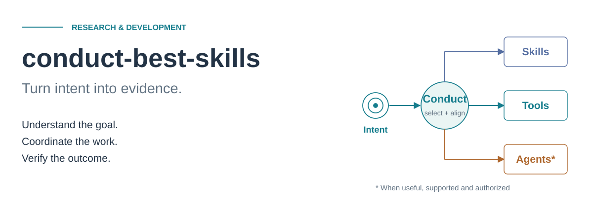
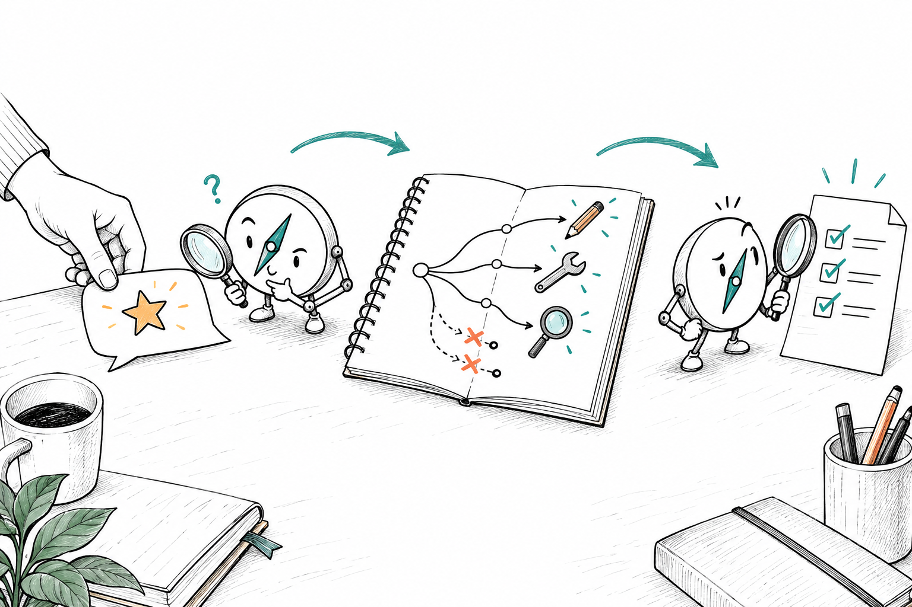
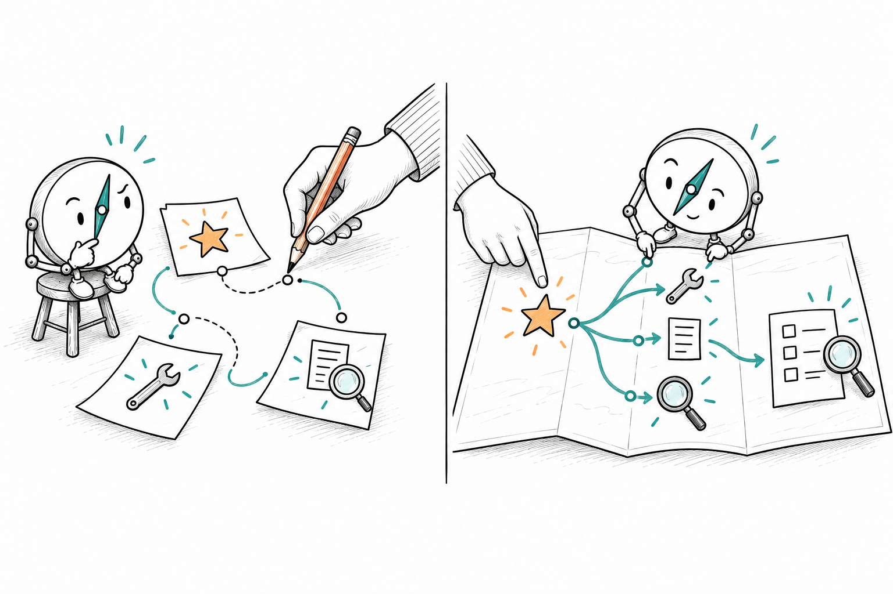
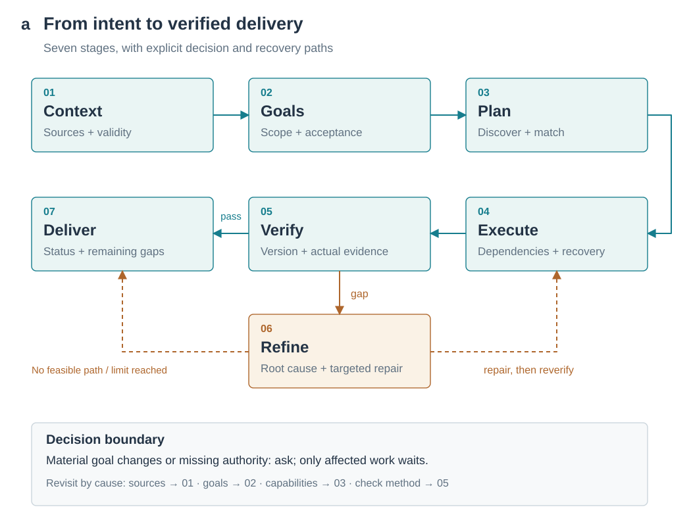
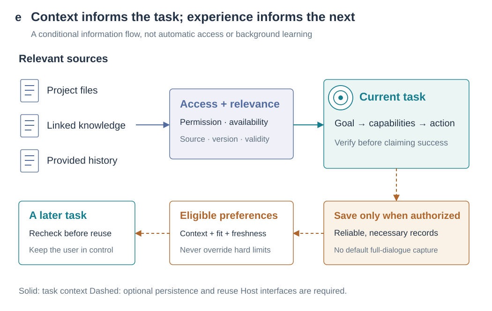
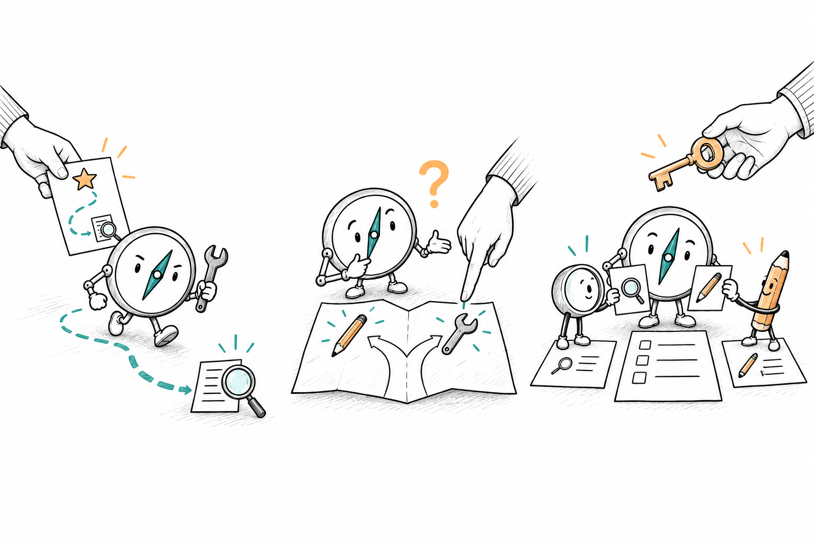
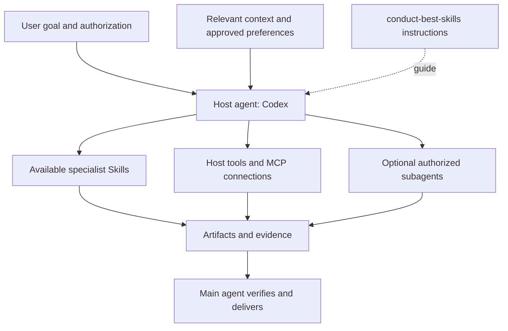

<div align="center">



# conduct-best-skills

**Turn intent into evidence.**

A coordinating Skill for research and development that connects context, capabilities and execution around the outcome you actually want—with evidence to assess the result.

[](LICENSE)
[](skills/conduct-best-skills/SKILL.md)
[](evals/README.md)

English · [简体中文](README_CN.md)

[Our purpose](#our-purpose) · [Quick start](#quick-start) · [Workflow](#how-it-works) · [Examples](#examples) · [Architecture](docs/architecture.md)

</div>

## Our purpose

Does any of this sound familiar?

- Codex follows your prompt, but misses the outcome you had in mind.
- You have installed plenty of Skills, MCP connections and tools, yet choosing when and how to combine them still takes work—for you and for Codex.
- Complex tasks keep pulling you back into instruction, correction and replanning.
- Important context lives in ChatGPT, Notion and project files, but does not adequately inform the current task.
- Every new task starts with another explanation of your working habits and preferences.
- Execution finishes, but you still cannot tell whether the result meets your expectations.

**What if a Skill could help Codex clarify your goals proactively, coordinate available capabilities, carry work through execution and repair, verify the outcome, and—with your permission—learn from experience to better understand how you work?**

That is the future conduct-best-skills is working toward:

> **Help Codex go beyond completing what you said, toward doing the best possible job of what you meant to accomplish.**



*Understand the goal, select the capabilities, then verify the result. An original conceptual illustration, not a recorded execution or a guarantee of success.*

“Best” is defined by your agreed goals, quality requirements and resource limits. Understanding intent means using evidence to clarify and suggest improvements; material changes to the goal remain your decision.

The current version expresses this ambition as seven-stage workflow instructions. Cross-platform context needs available host connections and authorization; experience across tasks needs approved storage and reliable records. The rules still require behavioral evaluation. This vision is not a claim of automatic integrations, autonomous learning or guaranteed results.

A **Skill** is a folder of instructions an agent reads when needed. This repository provides **one coordinating Skill**, with seven stage references. Your host supplies the model, tools and optional subagents; separately installed specialist Skills supply domain methods.

> **Now includes an executable local companion.** The Skill ships dependency validation, capability filtering, actual check execution, version-bound evidence, unknown-operation reconciliation and recovery reports. See the [validation record](docs/validation.md) for regressions and demonstrations. The 204 Agent behavior cases remain `NOT_RUN`; the earlier three-task A/B pilot showed no core outcome gain, and no improved model performance is claimed.

## Quick start

You need a Codex environment that discovers local Skills and can read project files. The optional local companion, checks and packaging need Python 3.10+; no Python packages or project-specific API keys are required. Specialist tools may have their own dependencies.

Download and extract this repository, then open a terminal **at its root**. For a first project-local installation, choose one block. An existing destination is deliberately left untouched.

**PowerShell**

```powershell
$skillTarget = '.agents/skills/conduct-best-skills'
if (Test-Path -LiteralPath $skillTarget) { throw 'Skill already exists; review before updating.' }
New-Item -ItemType Directory -Force '.agents/skills' | Out-Null
Copy-Item -LiteralPath 'skills/conduct-best-skills' -Destination $skillTarget -Recurse
Copy-Item -LiteralPath 'LICENSE' -Destination "$skillTarget/LICENSE"
Test-Path -LiteralPath "$skillTarget/SKILL.md"
```

**Bash / macOS / Linux**

```bash
skill_target='.agents/skills/conduct-best-skills'
if [ -e "$skill_target" ]; then
  printf '%s\n' 'Skill already exists; review before updating.'
else
  mkdir -p .agents/skills &&
  cp -R skills/conduct-best-skills "$skill_target" &&
  cp LICENSE "$skill_target/LICENSE" &&
  test -f "$skill_target/SKILL.md" && printf '%s\n' 'Skill files installed.'
fi
```

Open a new Codex chat in this project. Confirm `conduct-best-skills` appears in the available Skills, then send:

```text
Use $conduct-best-skills with the Balanced strategy.
Read this repository's README and Skill entry point. Explain the project's
purpose and implementation limits, citing the files you read. Do not edit files.
```

The expected output is a short, source-backed explanation. Check that the host actually loads the Skill; file presence alone does not prove discovery or correct behavior. If missing, check the project's path and host settings against the [official Skills documentation](https://learn.chatgpt.com/docs/build-skills).

No extra configuration is required by this package. Specify **Quality First**, **Balanced**, **Adaptive**, or **Custom** in ordinary language. An explicit strategy takes precedence over a user-saved default. If neither exists, choose an approach proportionate to task risk and size. Ask only about unresolved material quality, time, or cost tradeoffs. Simple tasks proceed directly without seven-stage narration or a full contract.

| Environment | Evidence and support boundary |
| --- | --- |
| Codex with local Skill discovery | Intended host; `SKILL.md` and `agents/openai.yaml` supplied. Copy layout checked on Windows; fresh-host discovery and behavior not certified. |
| Other Skill-aware agents | Potentially adaptable Markdown; installation, invocation and runtime behavior unverified. |
| Windows / Linux package CI | Workflow configured for both; local Windows checks run. No remote CI result claimed. |

## Run it and inspect the evidence

Run these commands in the source repository. The demonstration creates a new directory only; choose another name if it already exists.

```sh
python skills/conduct-best-skills/scripts/demo.py --output local/conduct-demo
python skills/conduct-best-skills/scripts/conduct.py --workspace local/conduct-demo report --format markdown
```

It produces real check logs, JSON evidence and a Markdown report through **FAIL → PASS → user edit makes evidence STALE → unknown operation causes BLOCKED → reconciliation and recheck PASS**. It checks that the added code survives and the simulated record is not duplicated. A fixed fixture patch demonstrates the mechanism; this is not an autonomous Agent repair trial.

The useful difference: **an old passing check stops counting after its tracked files change; rerunning an upstream check also invalidates dependent evidence.** Each `status` call rechecks versions and explains next actions and remaining attempts. Capability routing explains exclusions before considering preferences.

For a real task, ask the host to use $conduct-best-skills, establish acceptance from current requirements, enable project-local evidence, repair failed checks and deliver a report for the current artifacts. The host implements and applies domain judgment; the companion records and checks evidence. See the [runtime guide](skills/conduct-best-skills/references/runtime.md) for contracts, recovery and capability catalogs.

## Why a coordinating Skill?

To move toward this vision, the coordinating Skill carries the intended outcome through capability selection, execution and acceptance. It organizes the handoffs you would otherwise have to manage, so each step has a clear reason to contribute to the result.



*Left: the user connects separate pieces. Right: a shared goal organizes capabilities and checks. This compares organization, not measured performance.*

| Without a shared workflow, you may need to… | These instructions organize that work by… |
| --- | --- |
| Choose Skills before the task is clear | Clarifying scope and acceptance before selecting capabilities |
| Repeat context for each step | Reading associated, accessible sources and handing off constraints and decisions |
| Re-explain working habits in new tasks | Reusing applicable preferences when saving is authorized and real records exist |
| Coordinate independent and dependent work | Mapping dependencies, ownership and verification nodes |
| Decide whether “done” means “correct” | Linking each necessary requirement to an artifact version and evidence |

This compares organization methods, not measured speed or quality improvements.

## How it works



1. **Context:** read applicable rules and relevant sources; deepen investigation when risk or gaps justify it.
2. **Goals:** distinguish requests, assumptions and suggestions; define success.
3. **Plan:** discover available Skills, tools and agents; filter hard constraints before comparing cost and fit.
4. **Execute:** respect dependencies and write ownership; reconcile unknown write outcomes before retrying.
5. **Verify:** check actual artifacts against necessary criteria using traceable evidence.
6. **Refine:** target root causes, preserve valid work, and reverify affected results within finite limits.
7. **Deliver:** report artifacts, evidence and remaining gaps with an accurate completion status.

Clear, authorized work continues. Material goal changes or missing permissions require a decision; only affected work waits. Source changes return to context, goal changes to goals, and capability changes to planning. Fallback must preserve necessary standards; otherwise, hand off the blocked or partial result honestly. [Detailed transitions and editable Mermaid source](docs/architecture.md).

## Core capabilities

| Capability | What is implemented in the instructions |
| --- | --- |
| Context proportional to risk | L1–L3 depth; provenance, version and decision-state checks; no blanket account scan |
| Goal negotiation | Routine clarification proceeds; optional improvements remain suggestions; material changes need explicit agreement |
| Capability selection | Visible metadata → accessible catalogs → relevant external discovery for meaningful gaps; no automatic installation |
| Conditional orchestration | Single agent by default; useful, supported and authorized delegation with dependencies and write boundaries |
| Evidence and recovery | Separate execution from verification; bounded recovery, version-aware checks and targeted refinement |
| Optional preferences | Authorized preferences rank eligible candidates; persistence and observations require actual host support |

All six have workflow instructions; capability filtering, dependencies, version-bound evidence and recovery also have executable local support. Full Agent behavioral acceptance is pending. Program regressions do not establish model compliance or an overall gain against a baseline. [Claim-to-source audit](docs/audit.md).

### How context and experience inform the work



Solid arrows show current-task information; dashed arrows show optional persistence and reuse. Sources such as ChatGPT and Notion require actual host connections or user-provided material. Preference reuse also requires authorization, reliable records and an applicability check.

## Working with the agent



*Left to right: A, proceed within a clear scope; B, ask about a material ambiguity; C, collaborate when permitted. The key represents authorization; the unfilled checklist still requires verification.*

**A · Clear task.** A bounded bug fix can move through relevant context, implementation and tests without asking you to approve the same scope again.

**B · Unclear goal.** “Improve this module” may mean a local fix or a redesign. The agent checks evidence, then asks about a material unresolved choice while continuing independent, authorized investigation.

**C · Several capabilities.** Independent work may run concurrently when supported and allowed. Dependent steps wait for inputs. The main agent checks returned evidence before integrating results. The illustration shows conceptual scenarios, not a recorded successful run.

## Examples

These are reproducible **evaluation recipes**, grounded in the [case catalog](evals/cases.json), not success stories. Every corresponding behavior case is still `NOT_RUN`.

| Input | Key decision / capabilities | Confirmation boundary | Expected deliverable |
| --- | --- | --- | --- |
| “Balanced: fix this small bug and run the relevant check.” | Light planning; file tools and applicable tests (`stage-4-7/X01`) | Scope or authority changes | Patch and actual test evidence |
| “Balanced: improve this module.” | Resolve local improvement vs redesign (`stage-2/T34`) | Material ambiguity needs goal negotiation | Agreed scope and a plan |
| “Balanced: review two independent modules; use subagents if supported and permitted.” | Separate read scopes; integrate evidence (`stage-4-7/E02`) | Delegation must be allowed | Combined findings with references |
| “Balanced: verify this artifact after the latest edit.” | Bind checks to the current version (`stage-4-7/V11`) | No repeat confirmation for authorized checks | Fresh evidence for the current artifact |

See [fixtures, full prompts and failure checks](docs/examples.md). No particular specialist Skill or connector is bundled or guaranteed.

## Architecture and design



This is a **logical architecture**. The host reads Markdown and operates through its own interfaces. The optional local companion persists contracts, checks and recovery records and verifies versions. The host still drives the seven stages; they are not background services.

The design separates **context depth from planning depth; suggestions from accepted goals; operation success from verified output.** Every extra Skill, agent or retry should serve a requirement. Simple tasks can stay in the conversation.

| Repository area | Purpose |
| --- | --- |
| [skills/conduct-best-skills/](skills/conduct-best-skills/) | One entry, seven stage references, local CLI and demo, contracts, learning rules and UI metadata |
| [evals/](evals/) | 204 design cases and a manual behavior evaluation protocol |
| [docs/](docs/) | Architecture, recipes, evidence audit, visual design and validation |
| [assets/](assets/) | Original editable SVGs and Mermaid workflow source |
| [scripts/](scripts/) | Standard-library checks, visual generation and allowlist ZIP packaging |

## Limits and next steps

The package provides opt-in project-local JSON state and check logs. It has no background scheduler, permission interceptor, general event collector or agent isolation layer. It cannot guarantee remote cancellation, inspect inaccessible history, or make unavailable tools usable. Cross-platform memory and cross-project preferences still need real interfaces and authorization. Skill instructions are currently in Chinese; bilingual READMEs do not imply an English translation of the Skill itself.

Progress toward this vision requires real-task evidence that goal understanding, capability composition, context reuse and preference learning work as intended.

**Proposed next work, not shipped capabilities:** publish anonymized P0 behavior evidence; repeat representative cases against a no-Skill baseline; document host discovery and compatibility results. No speedups, model-specific success rates or automatic learning guarantees are claimed.

## Build and contribute

```sh
python scripts/check_package.py
python scripts/check_docs.py
python scripts/validate_runtime.py
python scripts/build_release.py
python scripts/check_release.py
```

The build creates `dist/conduct-best-skills-source.zip` (public source, docs and visuals) and `dist/conduct-best-skills-skill.zip` (standalone Skill and license). An explicit allowlist excludes private design material and local state. Unzip the **Skill** archive into your host's Skill directory, preserving its `conduct-best-skills/` folder. The source archive is for the whole repository.

Read [Contributing](CONTRIBUTING.md), [Security](SECURITY.md), the [evaluation protocol](evals/README.md) and [Changelog](CHANGELOG.md). Issue/PR templates are included. Behavioral evaluations remain NOT_RUN; static validation does not establish behavioral effectiveness.

## Feedback and suggestions

Use [Issues → New issue](https://github.com/shan2223/conduct-best-skills/issues/new/choose) to share feedback, report bugs or suggest improvements. Search existing issues first; add evidence to an existing discussion when it covers the same problem.

- **Bug reports:** choose the Bug report template. Include the task context, expected outcome, actual behavior, reproduction steps, Skill version and host environment, ideally with a minimal sanitized example.
- **Improvement suggestions:** choose the Feature request template. Describe the problem, the outcome you want and how the improvement could be evaluated.
- **Code and documentation contributions:** open an issue to discuss the change, then submit a pull request. See [Contributing](CONTRIBUTING.md) for guidance.

Do not post API keys, private conversations, personal information or unpublished project material in public issues or pull requests. Follow [Security](SECURITY.md) for security and privacy concerns.

## Acknowledgements and license

Thanks to [Nature Skills](https://github.com/Yuan1z0825/nature-skills) for inspiration in task-oriented examples, installation documentation and academic diagrams, and to **Ian Xiaohei Illustrations** for inspiration in hand-drawn explanatory art and visual storytelling. Their images and text are not reused. See [design notes](docs/visual-design.md).

Code, documentation and original visuals use the [MIT License](LICENSE).
