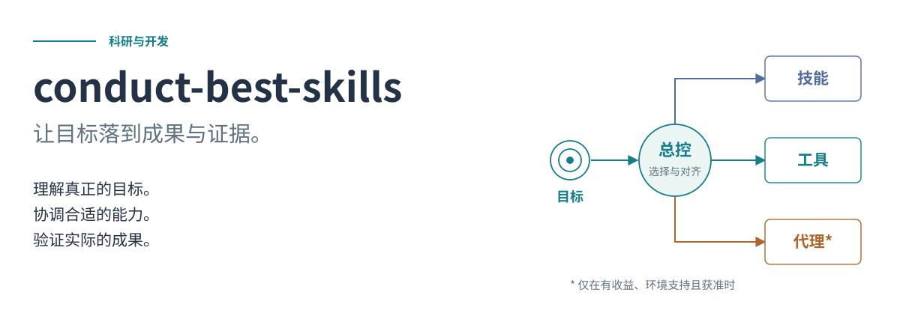
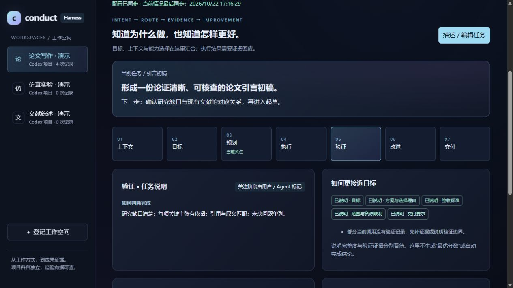
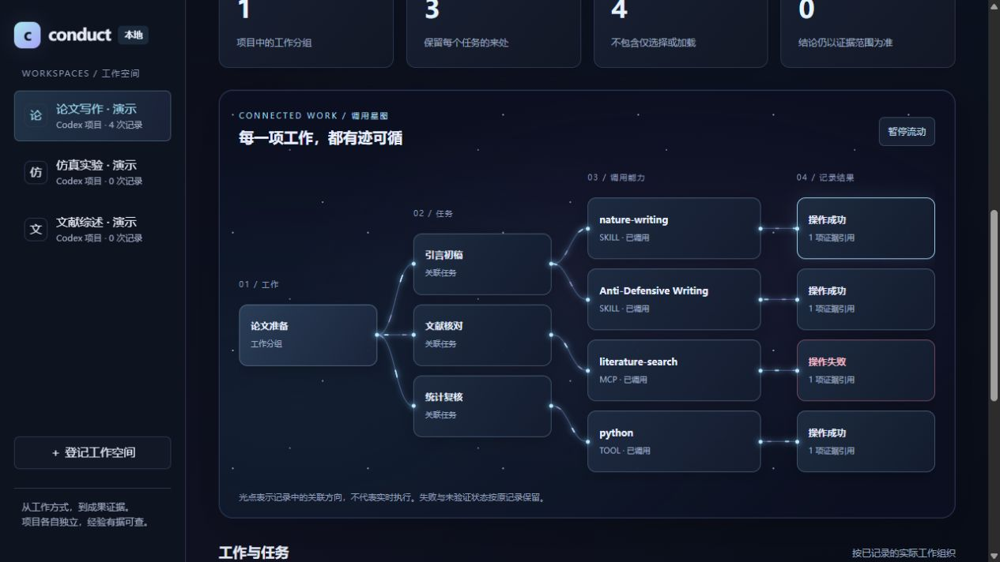
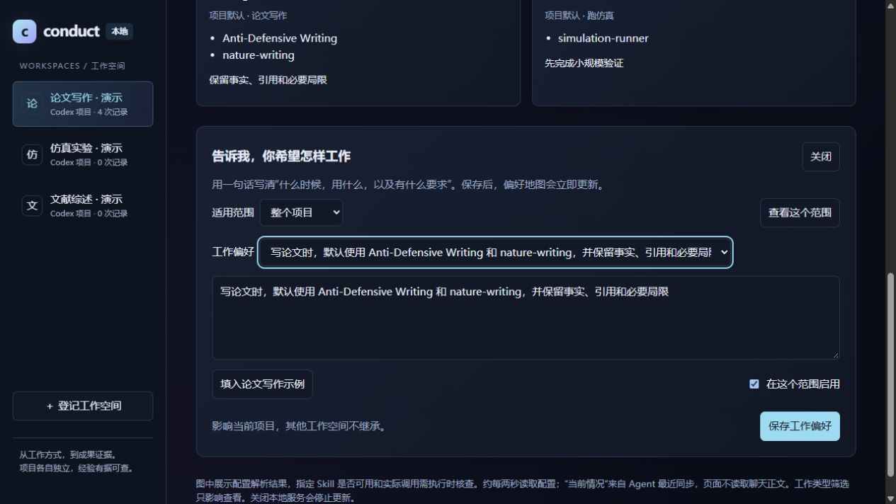
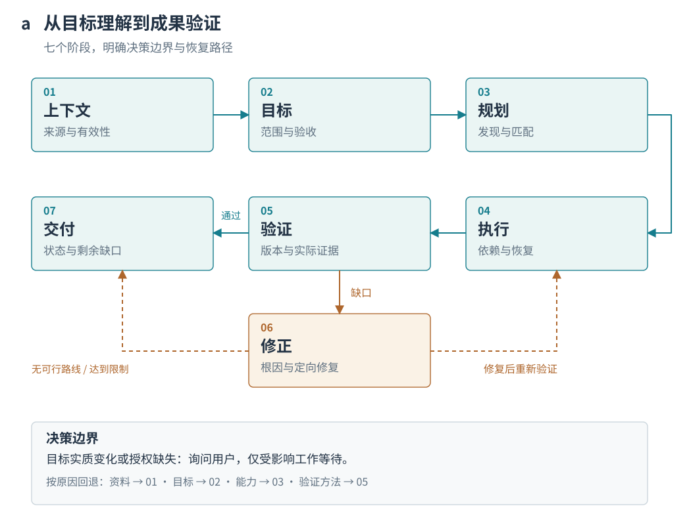
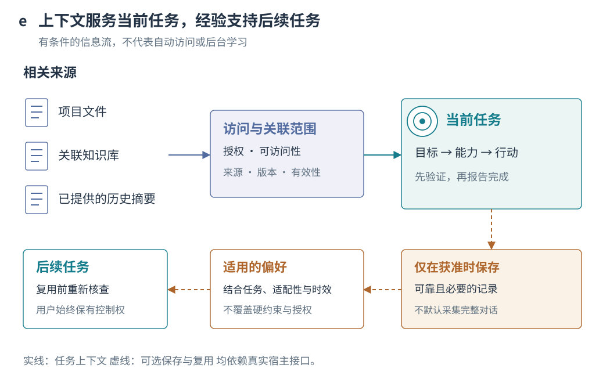
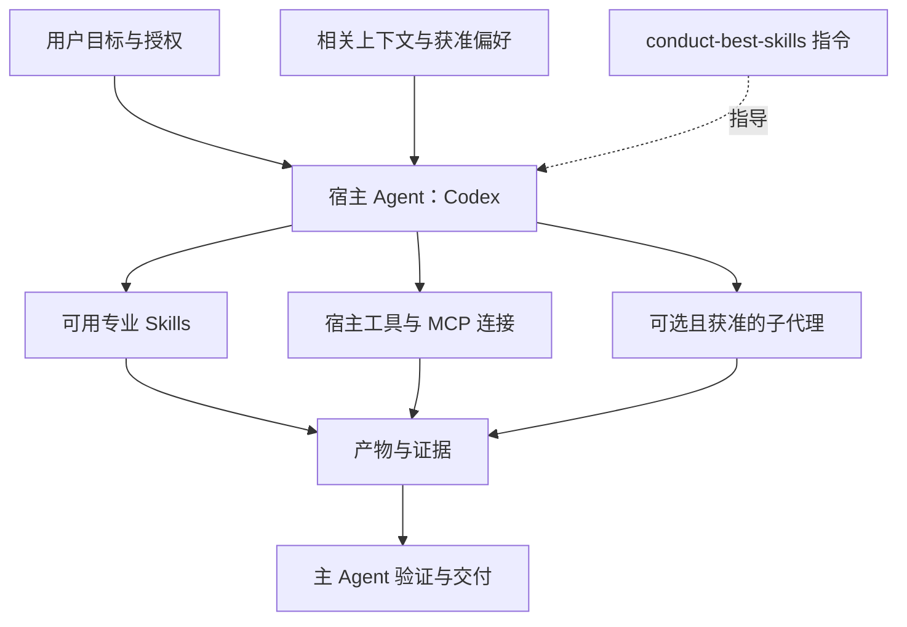

<div align="center">



# conduct-best-skills

**Turn intent into evidence. · 让目标落到成果与证据。**

面向科研与开发的 Agent Harness 工作台：理解任务、选择方案、统筹 Skills / MCP / 工具，并用实际证据判断成果与改进方向。

[](LICENSE)
[](skills/conduct-best-skills/SKILL.md)
[](evals/README.md)

[English](README.md) · 简体中文

[项目主旨](#项目主旨) · [快速开始](#快速开始) · [可视工作台](#可视工作台) · [工作流程](#工作机制) · [使用实例](#使用实例) · [技术架构](docs/architecture.md)

</div>

## 项目主旨

安装后可以直接用自然语言开始，不必选流程、填契约或记工具命令：

| 你想做什么 | 可以直接这样说 | 应拿到什么 |
| --- | --- | --- |
| 实现需求 | `用 $conduct-best-skills 把这个需求做成能运行的工具，先跑通最小完整流程，再补齐必要功能。` | 可运行成果、使用方法和实际检查 |
| 优化项目 | `用 $conduct-best-skills 找出这个项目最影响使用的问题，完成改进，并给出前后依据。` | 针对性修改、改善证据和剩余问题 |
| 接着继续 | `用 $conduct-best-skills 接着上次做，保留我的新修改，从当前可信进度继续。` | 核对过的续接点和当前版本成果 |

普通问答和一句话修改直接处理。复杂任务由 Agent 按需选择专业 Skill；启用本地证据工具时，也由 Agent 负责配置。

**当前检查：**164 项程序回归（162 项通过、2 项因环境条件跳过）、工作台浏览器检查与发布包解压运行检查。此前三个全新上下文小任务试用单独保留，不等于完整行为验收。[验证记录与适用范围](docs/validation.md)。

你是否也遇到过这些情况？

- Codex 执行了你的 Prompt，却没有充分理解你真正想要的结果。
- 安装了很多 Skills、MCP 和工具，你仍不知道什么时候该用什么，Codex 也未必能选好、组合好。
- 复杂任务推进到一半，仍需要你反复指导、纠错和重新规划。
- ChatGPT、Notion 和项目文件里有重要上下文，却未能充分进入当前任务。
- 每次开始新任务，都要重新说明自己的工作习惯和偏好。
- 任务执行结束了，却难以判断成果是否真正达到预期。

**如果有一个 Skill，能够帮助 Codex 主动理解你的目标、合理编排可用能力、自主推进执行与修正、严格验证成果，并在你授权的范围内积累经验，让它越用越懂你，会怎么样？**

这就是 conduct-best-skills 想要实现的未来：

> **让 Codex 不只是完成你说的事，而是尽可能把你想做的事做到最好。**


*先理解目标，再选择能力，最后凭证据交付。原创概念插画，不代表实际执行记录或成果保证。*

这里的“最好”，以你确认的目标、质量要求和资源边界为准。理解意图意味着结合证据主动澄清与提出建议；实质改变目标时，决定权仍在你手中。

当前版本通过实现、优化和继续三条任务路径组织工作，七阶段参考按需提供判断依据。跨平台上下文仍需宿主连接和授权，跨任务经验积累需要获准存储和真实记录；小样本试用不能理解为全自动连接、学习或结果保证。

**Skill** 是 Agent 按需读取的一组指令文件。本仓库提供**一个总控 Skill 和 13 个独立能力入口**，共享七阶段参考与本地工具。模型、工具和可选子代理由宿主提供；专业方法由另行安装的专业 Skills 提供。

> **现在包含可运行的本地闭环工具。** 随 Skill 提供任务依赖校验、能力筛选、实际检查执行、文件版本与证据绑定、未知操作核对及恢复报告。工具回归与演示见[验证记录](docs/validation.md)。204 项 Agent 设计场景仍为 `NOT_RUN`；旧版三组 A/B 双方核心任务均通过，尚无模型效果提升证据。

## 快速开始

需要能够发现本地 Skills、读取项目文件的 Codex 环境。可选闭环工具、检查与打包命令需要 Python 3.10+，无需额外 Python 包或本项目专用 API Key。专业工具可能有独立依赖。

下载并解压本仓库，在**仓库根目录**打开终端。首次项目级安装选择以下一组命令；目标目录已经存在时不会覆盖。

**PowerShell**

```powershell
$skillTarget = '.agents/skills/conduct-best-skills'
if (Test-Path -LiteralPath $skillTarget) { throw 'Skill already exists; review before updating.' }
New-Item -ItemType Directory -Force '.agents/skills' | Out-Null
Copy-Item -LiteralPath 'skills/conduct-best-skills' -Destination $skillTarget -Recurse
Copy-Item -LiteralPath 'LICENSE' -Destination "$skillTarget/LICENSE"
Test-Path -LiteralPath "$skillTarget/SKILL.md"
```

**Bash / macOS / Linux**

```bash
skill_target='.agents/skills/conduct-best-skills'
if [ -e "$skill_target" ]; then
  printf '%s\n' 'Skill already exists; review before updating.'
else
  mkdir -p .agents/skills &&
  cp -R skills/conduct-best-skills "$skill_target" &&
  cp LICENSE "$skill_target/LICENSE" &&
  test -f "$skill_target/SKILL.md" && printf '%s\n' 'Skill files installed.'
fi
```

在该项目中新建 Codex 对话，确认可用 Skills 中出现 `conduct-best-skills`，然后发送：

```text
请使用 $conduct-best-skills，以 Balanced 策略读取本仓库的 README 和 Skill 入口。
说明项目用途与实现边界，并引用实际读取的文件。不要修改文件。
```

预期产物是一份简短、有来源依据的说明。检查宿主是否实际加载了 Skill；文件存在不等于发现成功或行为正确。如果没有出现，请参照[官方 Skills 文档](https://learn.chatgpt.com/docs/build-skills)检查项目路径与宿主设置。

技能包无需额外配置。可以用自然语言指定 **Quality First、Balanced、Adaptive 或 Custom**。当前明确策略优先于用户主动保存的默认值；两者都没有时，按风险和规模自主选择方式。只有重要的质量、时间或成本取舍无法消解时才询问，普通任务直接推进。简单任务无需展示七阶段或填写完整契约。

| 环境 | 证据与支持边界 |
| --- | --- |
| 支持本地 Skill 发现的 Codex | 目标宿主；提供 `SKILL.md` 与 `agents/openai.yaml`。Windows 复制布局已检查；新宿主发现与行为未认证。 |
| 其他支持 Skills 的 Agent | Markdown 理论上可适配；安装、调用和运行行为未验证。 |
| Windows / Linux 打包 CI | 已配置双平台工作流；本地执行了 Windows 检查，不声称远程 CI 已通过。 |

## 独立命令与工作空间偏好

保留 `$conduct-best-skills` 自动总控，也可以直接指定本次工作：

| 命令 | 负责的工作 |
| --- | --- |
| `$conduct-context` / `$conduct-goals` | 核查上下文 / 澄清目标 |
| `$conduct-plan` / `$conduct-discover` | 规划工作 / 发现能力 |
| `$conduct-build` / `$conduct-improve` | 实现需求 / 有依据地优化 |
| `$conduct-resume` | 从当前可信进度继续 |
| `$conduct-verify` / `$conduct-refine` | 只验证 / 定向修正并重验 |
| `$conduct-deliver` | 整理现有成果与移交 |
| `$conduct-preferences` | 编辑项目默认与任务覆盖，打开动态偏好框架图 |
| `$conduct-workbench` | 打开工作台，同步 Codex 项目与近期聊天 |
| `$conduct-reflect` | 按任务复盘能力使用、证据与用户反馈 |

使用全部独立入口请安装 **`dist/conduct-best-skills-suite.zip`**，保留 14 个同级技能目录。上面的单核心安装也支持 `$conduct-best-skills plan ...` 等形式，首个参数对应命令名称。每个入口有自己的停止边界，只规划、只验证不会自动变成实现。

每个工作空间有可编辑的 `.conduct/preferences.json`，可用 `.conduct/tasks/<task-id>/preferences.json` 覆盖特定任务。优先级为当前 prompt > 任务覆盖 > 项目默认；其他工作空间不继承。例如设置“论文写作默认调用 **Anti-Defensive Writing**”后，Agent 会检查真实可用性、加载并应用；本次明确说不用则临时排除，不改保存的默认。本包不包含该示例专业 Skill。

`$conduct-preferences` 可以打开项目默认 → 任务覆盖 → 当前 prompt → 当前规则的动态图，约每两秒重读文件，并提供带校验和版本冲突检查的自然语言编辑器。图展示配置，不冒充实际调用证据；任务当前情况由 Agent 同步并显示时间，本机服务停止后会提示更新中断。[完整命令、安装与偏好说明](docs/commands-and-preferences.md)。

## 可视工作台

任务驾驶舱贯穿 **上下文 → 目标 → 规划 → 执行 → 验证 → 改进 → 交付**。目标、依据、约束、方案与选择理由、验收标准、改进基线、下一步和交付要求，都可以直接用自然语言编辑。保留项目默认与任务覆盖，当前 prompt 的明确要求优先。



*图中项目、任务说明、调用和反馈均为虚构展示数据。*

驾驶舱将任务意图与能力安排、实际调用证据关联。每次调用绑定当时的任务说明；目标或标准变化后，旧调用会提示重新核对。已有执行契约还可显示任务依赖、检查状态、证据、剩余尝试与未知操作。浏览不会运行检查；填写说明、实际调用、产物通过验收分别判断。

产品由指令型 Skill 与本地辅助工具组成。Codex 项目/聊天通过快照接入，调用记录为部分覆盖；改进提示帮助发现缺口，不声称已求得全局最优。

从项目开始设定工作偏好，再在同一个本地工作台中回看任务、能力调用和结果。深色界面采用星空底色、发光丝线和流动光点，连接 **工作 → 任务 → Skill / MCP / 工具 → 已记录结果**。动画可以暂停；系统开启减少动态效果时保持静止。



*真实前端使用虚构项目、聊天、调用和反馈渲染。光点表达保存记录中的关联方向，不代表实时执行、真实项目成果或性能测量。*

| 视图 | 可以做什么 |
| --- | --- |
| 工作总览 | 切换工作空间，查看近期 Codex 聊天快照、已记录工作与任务 |
| 偏好地图 | 用自然语言编辑规则，查看项目默认、任务覆盖和当前 prompt 临时排除 |
| 调用与复盘 | 筛选 Skills、MCP 与工具，查看结果和证据引用，添加使用反馈并导出复盘 |



可以直接说：**“用 $conduct-workbench 打开工作台并同步我的 Codex 项目。”** 然后说：**“这个项目写论文时，默认使用 Anti-Defensive Writing 和 nature-writing，并保留事实、引用与必要局限。”** 用户无需填写配置代码。编辑器可保存常见偏好句式，复杂表达由 Codex 理解后保存；指定能力必须实际可用。

项目和近期聊天通过宿主官方工具同步为带时间的快照，需要更新时再说“同步工作台项目”。页面自动读取已保存文件，尚未实时订阅 Codex 变更，也不会捕获所有工具调用。导入索引不会修改其他项目的偏好。需要后续聊天接续工作方式时，可由 Agent 对明确指定的项目执行 `workbench onboard`。

公开展示页只使用临时生成的虚构数据，且拒绝写入：

```sh
python scripts/preview_workbench.py
```

打开返回的本地网址，切换“调用与复盘”或“偏好地图”即可查看。这个展示入口不会导入你的 Codex 索引或读取已有项目历史。[完整用法与数据边界](docs/commands-and-preferences.md)。

## 先运行一次，看见实际作用

在源码仓库运行下面命令。演示仅创建一个新目录；目录已存在时换一个名字，避免覆盖已有结果。

```sh
python skills/conduct-best-skills/scripts/demo.py --output local/conduct-demo
python skills/conduct-best-skills/scripts/conduct.py --workspace local/conduct-demo report --format markdown
```

你会得到实际执行的检查日志、JSON 证据和 Markdown 报告。演示经历 **FAIL → PASS → 用户修改触发 STALE → 未知操作触发 BLOCKED → 核对并重验 PASS**；检查保留新增代码且没有重复模拟记录。它用预设补丁展示确定性机制，不代表 Agent 自动修复实验。

最有用的变化是：**文件已经改了，旧的“测试通过”不会继续被当作当前结论；上游重验也会使依赖它的旧证据失效。** `status` 每次重新核对，给出下一步和剩余尝试次数。能力路由则列出候选为什么不可用，避免高偏好覆盖硬约束。

工具还支持 `start` 建立单条件任务、`verify-ready` 按依赖检查、`next` 提供简短续接动作。Agent 根据实际加载的 Skill 目录定位脚本，安装位置不必在用户项目内。[三步工具用法](skills/conduct-best-skills/references/runtime.md)。

实际任务可发送：“使用 $conduct-best-skills 完成这个项目的修复；按当前要求建立验收，启用项目内证据记录，遇到失败定向修正，交付当前版本的验证报告。”宿主负责实现和专业判断，本地工具负责记录和核验。完整契约、恢复及能力目录格式见[工具指南](skills/conduct-best-skills/references/runtime.md)。

## 从多个来源发现适用能力

新增发现工具优先搜索本地 Skill；有缺口且允许外搜时，再查询 OpenAI Plugins、Anthropic Skills、Skills.sh、SkillsMP 和 GitHub。它解析真实 Skill 文件、记录仓库固定版本、保留多来源线索、解释排序并建议互补组合。原生能力足够的步骤无需额外 Skill。

```sh
python skills/conduct-best-skills/scripts/conduct.py --workspace . discover --root skills --keyword research --need research --output local/discovery.json
```

外搜需要启用；凭据使用、安装、加载、执行和添加 MCP 仍分别遵守授权。发现本身不会把候选标成可运行，各来源的可用范围也不相同；有界元数据匹配不代表质量或安全认证。查看[配置与六源示例](skills/conduct-best-skills/references/discovery.md)、[适配器架构](docs/discovery-design.md)、[实际测试和在线限制](docs/discovery-validation.md)。

## 为什么需要总控 Skill？

为了接近这个愿景，总控 Skill 将“理解你想实现什么”贯穿能力选择、执行和验收。它把原本需要你反复衔接的环节组织成共同流程，让每一步都能说明它对最终结果的价值。


*左：用户手动衔接零散信息；右：围绕共同目标组织能力与检查。比较组织方式，不表示已测得效率提升。*

| 缺少共同流程时，你可能需要…… | 这套规则如何组织这些工作 |
| --- | --- |
| 还没明确任务就先选 Skill | 先明确范围与验收，再选择能力 |
| 在每一步重复交代上下文 | 按需读取已关联且可访问的来源，交接明确约束与决策 |
| 在新任务中重复说明习惯 | 在已有保存授权及真实记录支持下，复用适用偏好 |
| 手动协调独立任务与依赖任务 | 映射依赖、资源所有权和验证节点 |
| 判断“做完”是否代表“正确” | 将必要要求关联到产物版本与证据 |

这里比较的是组织机制，不是经过测量的效率或质量提升。

## 工作机制



1. **上下文：**读取适用规则和相关来源，根据风险与缺口加深核查。
2. **目标：**区分原始请求、假设和建议，定义成功条件。
3. **规划：**发现可用 Skills、工具和 Agent，先过滤硬约束，再比较成本与适配性。
4. **执行：**遵守依赖与写入所有权；写入结果未知时先核对状态，再考虑重试。
5. **验证：**用可追溯证据检查真实产物是否满足必要条件。
6. **修正：**定位根因，保留有效成果，在有限预算内修复并重验受影响结果。
7. **交付：**给出产物、证据和剩余问题，准确说明完成状态。

明确且已授权的工作自动继续。目标实质变化或权限缺失需要用户决定，只有受影响的工作等待。资料变化回到上下文，目标变化回到目标阶段，能力变化回到规划。替代方案不能降低必要标准；否则准确移交阻塞或部分成果。[详细转移规则与可编辑 Mermaid 源码](docs/architecture.md)。

## 核心能力

| 能力 | 已写入的实际规则 |
| --- | --- |
| 与风险相称的上下文加载 | L1–L3 深度；核查来源、版本和决策状态，不扫描整个账户 |
| 目标协商 | 普通细化可继续；可选增强只建议；实质变化必须获得明确同意 |
| 能力选择 | 可见元数据 → 可访问目录 → 有实质缺口时扩展外部发现，不自动安装 |
| 有条件的协同编排 | 默认单 Agent；收益明确、环境支持且获准时委派，明确依赖与写入边界 |
| 证据与恢复 | 区分执行与验证；有限恢复、版本感知检查和定向修正 |
| 工作空间偏好与复盘 | 项目默认、任务覆盖、prompt 排除与显式调用履历；规则由宿主 Agent 实际应用 |

上述能力具有流程规则；其中能力筛选、依赖校验、版本证据及恢复另有可执行本地工具。完整 Agent 行为验收尚未完成，程序回归不证明模型一定遵守规则，也不证明相对基线的总体增益。[功能与来源对应审查](docs/audit.md)。

### 上下文如何进入任务，经验如何复用



实线表示当前任务的信息流，虚线表示可选的保存与复用。ChatGPT、Notion 等来源需要真实宿主连接或用户提供的材料；偏好复用也需要授权、可靠记录与适用性核查。

## 与 Agent 如何交互


*从左到右：A 明确任务直接推进；B 关键歧义由用户决定；C 获准后按需协作。钥匙代表授权，空白清单表示仍需验证。*

**A · 明确任务。** 范围清楚的小型修复可直接推进相关上下文、实现与测试，无须重复批准同一范围。

**B · 模糊目标。** “改进这个模块”可能意味着局部修复或重新设计。Agent 先核对证据，再询问仍未解决的实质选择，同时继续独立且已授权的调查。

**C · 多种能力。** 环境支持且允许时，独立工作可以并发；依赖任务等待输入。主 Agent 核查回传证据后再整合。图中场景是规则示意，并非成功运行实录。

## 使用实例

以下是基于[案例目录](evals/cases.json)的可复现**验收配方**，不是成功案例；对应行为场景均仍为 `NOT_RUN`。

| 任务输入 | 关键决策与能力 | 确认边界 | 预期交付 |
| --- | --- | --- | --- |
| “Balanced：修复这个小 Bug，运行相关检查。” | 轻量规划，文件工具与适用测试（`stage-4-7/X01`） | 范围或权限变化 | 补丁和真实测试依据 |
| “Balanced：改进这个模块。” | 辨别局部优化与重设计（`stage-2/T34`） | 关键歧义需要目标协商 | 明确范围与计划 |
| “Balanced：审查两个独立模块；支持且允许时使用子代理。” | 分开读取范围，整合证据（`stage-4-7/E02`） | 委派必须获准 | 带来源引用的综合发现 |
| “Balanced：按最新修改验证这个产物。” | 检查绑定当前版本（`stage-4-7/V11`） | 已授权检查不重复确认 | 当前产物的新验证证据 |

详见[夹具、完整 Prompt 与失败检查](docs/examples.md)。本包不附带或保证任何特定专业 Skill 或连接器。

## 架构与设计理念



这是**逻辑架构**。宿主读取 Markdown，通过自己的接口执行操作；可选本地工具将契约、检查和恢复记录保存为文件并核验版本。七阶段仍由宿主推进，不是后台运行的七个服务。

设计区分**上下文深度与规划深度、建议与已接受目标、操作成功与成果验证通过。** 每个额外 Skill、Agent 或重试都应服务于任务要求，简单任务可以只在对话中完成。

| 仓库区域 | 用途 |
| --- | --- |
| [skills/](skills/) | 共享总控核心、13 个能力入口、七阶段参考、本地 CLI、偏好图和 UI 元数据 |
| [evals/](evals/) | 204 项设计场景与人工行为评估协议 |
| [docs/](docs/) | 架构、验收配方、证据审查、视觉设计和验证记录 |
| [assets/](assets/) | 原创可编辑 SVG 与 Mermaid 流程源码 |
| [scripts/](scripts/) | 标准库检查、视觉生成与白名单 ZIP 打包 |

## 局限与下一步

本包提供显式启用的项目本地 JSON 状态和检查日志；不包含后台调度器、权限拦截器、通用事件采集器或 Agent 隔离层。它不能保证远程取消，不能读取不可访问的历史，也不能让缺失工具变得可用。跨平台记忆与跨项目偏好复用仍需真实接口及授权。执行指令目前使用中文；双语 README 不代表 Skill 正文已经英文化。

通向这一愿景，需要用真实任务证据逐步验证目标理解、能力组合、上下文复用与偏好积累是否有效。

**建议后续推进，尚未交付的内容：**公开匿名 P0 行为证据；将代表性场景与无 Skill 基线重复对比；记录宿主发现与兼容性结果。当前不宣称效率提升、特定模型成功率或自动学习保证。

## 构建与参与贡献

```sh
python scripts/check_package.py
python scripts/check_docs.py
python scripts/validate_runtime.py
python scripts/build_release.py
python scripts/check_release.py
```

构建生成 `dist/conduct-best-skills-source.zip`（公开源码）、`dist/conduct-best-skills-skill.zip`（独立核心）和 `dist/conduct-best-skills-suite.zip`（核心与 13 个能力入口）。明确白名单排除私有设计材料与本地状态。将 **suite 包**解压到宿主技能目录，保留 14 个同级文件夹；已有同名安装先备份并检查差异。source 包用于整个仓库。

请阅读[贡献指南](CONTRIBUTING.md)、[安全说明](SECURITY.md)、[验收协议](evals/README.md)和[变更记录](CHANGELOG.md)。仓库包含 Issue/PR 模板。行为评估仍为 NOT_RUN；静态验证通过不代表实际行为效果已经验证。

## 反馈与建议

欢迎通过 [Issues → New issue](https://github.com/Theseus-shan/conduct-best-skills/issues/new/choose) 提交使用反馈、Bug 和优化建议。提交前请先搜索已有 Issue；相同问题可以在原讨论中补充证据。

- **Bug 反馈**：选择 Bug report 模板，说明任务场景、预期结果、实际表现、复现步骤、Skill 版本与运行环境，并尽量提供脱敏后的最小示例。
- **优化建议**：选择 Feature request 模板，说明希望解决的问题、期望达到的结果，以及如何判断改进有效。
- **代码与文档贡献**：欢迎先开 Issue 讨论，再提交 Pull Request；具体要求见[贡献指南](CONTRIBUTING.md)。

请勿在公开 Issue 或 PR 中上传 API Key、私人对话、个人信息或未公开项目资料。安全与隐私问题请按[安全说明](SECURITY.md)处理。

## 致谢与许可证

感谢 [Nature Skills](https://github.com/Yuan1z0825/nature-skills) 为任务导向示例、安装说明与学术图解提供参考；感谢 **Ian Xiaohei Illustrations** 带来的手绘科普与视觉叙事灵感。本项目未复用其图片或文案，详见[设计说明](docs/visual-design.md)。

本轮还参考 [ARIS](https://github.com/wanshuiyin/Auto-claude-code-research-in-sleep) 的最小完整实现、恢复与停滞处理，以及 Nature Skills 的任务边界、按需加载和独立试用方法，并按本项目范围重新设计。[具体借鉴与取舍](docs/reference-study.md)。

代码、文档和原创视觉资源采用 [MIT License](LICENSE)。
