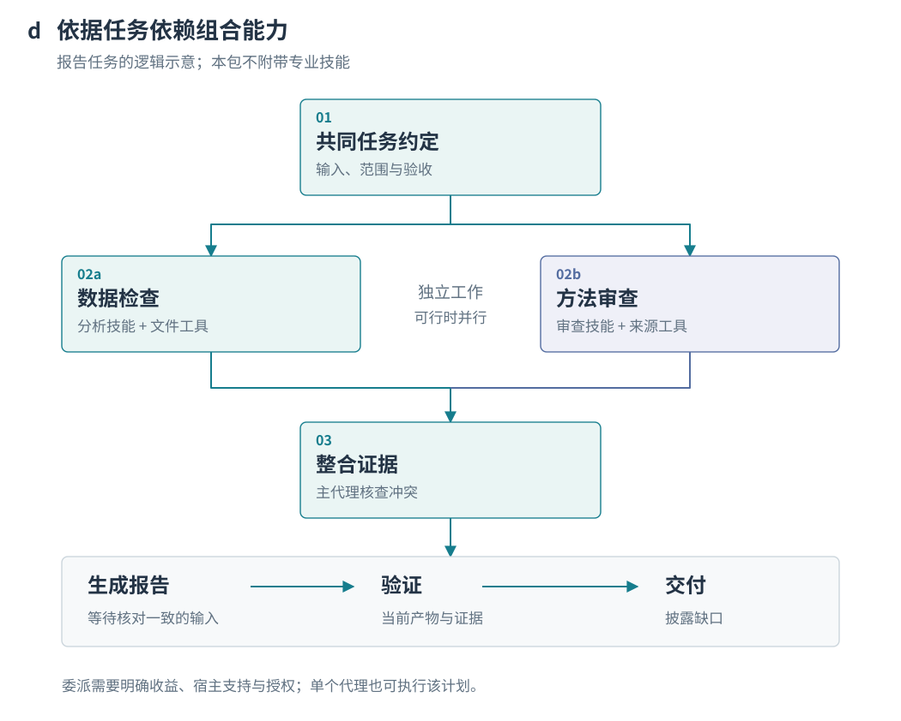

# Architecture / 技术架构

## Executable local companion / 可执行本地辅助工具

[Runtime guide](../skills/conduct-best-skills/references/runtime.md) describes the optional Python CLI shipped inside the Skill. The host defines acceptance, performs implementation and supplies observed capability facts. The companion validates the dependency graph, filters those candidates, executes reviewed checks, and stores project-local JSON state and evidence logs. `status` recomputes file and evidence hashes, detects stale dependencies, and supplies recovery actions. It does not schedule agents, grant permissions or provide automatic learning. Public metadata source adapters are described below. The instruction architecture below remains host-driven; earlier descriptions of absent runtime support refer to the seven-stage orchestration layer, not this new local companion.

[English README](../README.md) · [中文 README](../README_CN.md)

## Purpose before mechanism / 先有目标，再有机制

The architecture serves the outcome the user wants: understand intent, bring in relevant context, select suitable capabilities, execute and repair, and deliver evidence. Authorized preferences can inform later tasks when the host provides storage and observations. The seven stages organize these responsibilities; they are not the product's end goal.

架构围绕“尽可能把用户想做的事做到最好”组织：先理解目标与上下文，再选择能力并执行、修正和验证。每个阶段都应降低与成果有关的不确定性，而不是增加形式化步骤。跨任务经验复用以已有授权、真实记录和适用性为前提；实质性目标变化仍由用户决定。

## What actually runs / 实际运行边界

The host agent reads [SKILL.md](../skills/conduct-best-skills/SKILL.md), then the relevant stage references. The package now includes six metadata source adapters and a bounded discovery engine, alongside the local evidence companion. It supplies no background scheduler, execution-tool adapter, permission middleware or process manager. `agents/openai.yaml` is display metadata and a default prompt, not a subagent declaration.

宿主读取总控指令，再按需加载阶段文件。总控 Skill 与子 Skill 都是指令；工具和子代理属于宿主能力。七阶段是逻辑质量门，不是七个常驻进程，也不是七个独立可安装技能。

## Lifecycle / 生命周期

Editable branch-level source: [workflow.mmd](../assets/diagrams/workflow.mmd). The overview merges exceptional exits; the following rules explain their scope.

| Trigger / 触发条件 | Transition / 处理 |
| --- | --- |
| Relevant sources are sufficient | Continue; disclose nonblocking gaps. Increase context depth only where needed. / 非阻塞缺口不妨碍继续，按需深化。 |
| Ordinary reversible detail within scope | Resolve from evidence or state a limited assumption. / 普通可逆细节自行处理。 |
| Material goal, scope, route, resource or acceptance change | Stage 2; obtain or reuse explicit agreement. Silence is not consent. / 实质变化须确认，沉默不是同意。 |
| Relevant capability missing | Stage 3; assess a qualified fallback. External discovery does not authorize installation. / 评估替代能力，发现不等于获准安装。 |
| Independent work and supported, permitted delegation | May overlap with explicit ownership; otherwise stay single-agent. / 有条件并行，否则保持单 Agent。 |
| Dependency or shared-write conflict | Serialize dependent work or isolate ownership. Context isolation is not filesystem isolation. / 依赖串行，共享写入需协调。 |
| Write outcome unknown | Query current state before retry; preserve operation identity if supported. / 先核对状态，避免重复副作用。 |
| Verification finds a gap | Stage 6 locates the root cause; return to stage 1, 2, 3, 4 or 5 as appropriate. Reverify affected artifacts. / 定向回退并重验。 |
| Budget exhausted, no progress, infeasibility, missing authority or cancellation | Stop affected work and preserve valid results; do not label partial delivery complete. / 停止相关工作并准确移交。 |

## Three independent choices / 三个独立维度

- **Execution strategy:** Quality First, Balanced, Adaptive or Custom. Current request → applicable user-saved default → autonomous choice proportionate to risk and size; ask only about unresolved material tradeoffs. The package does not assign numeric budgets to these labels.
- **Context depth:** L1 necessary rules/materials; L2 related dependencies and decisions; L3 deeper evidence, assumption and version checks.
- **Planning depth:** P1 a few work nodes; P2 dependencies and capability mapping; P3 a detailed task graph and failure branches.

策略、上下文深度与规划深度不能混为一谈。Quality First 不代表无限资源；简单任务也不需要生成一套完整报告。

## Selection and delegation / 能力选择与委派

[Discovery design](discovery-design.md) extends stages 1–3 with source policy, capability requirements and progressive retrieval. The [usage guide](../skills/conduct-best-skills/references/discovery.md) covers Local, OpenAI Plugins, Anthropic Skills, Skills.sh, SkillsMP and GitHub adapters. Static inspection, version identity, conservative deduplication, metadata matching and greedy composition produce a plan; all runtime availability still requires host preflight. Stages 4–7 consume that plan, validate actual use, replan within remaining budgets and deliver source/version evidence. Discovery never recursively launches the coordinator or installs a candidate.

Discovery proceeds from visible metadata to accessible catalogs, then relevant trusted external sources only when a meaningful gap warrants expansion. Matching first checks domain fit, availability, permissions, dependencies, versions and necessary acceptance criteria. Cost and approved preferences rank only eligible candidates. A no-Skill baseline is considered for workflows that do not require a specialist.

发现、可用、选中、加载、调用、操作成功与成果验证是不同状态，不能互相代替。新安装、外部连接、历史调用次数和用户偏好均不能凭空假定。

This data-report scenario is a **logical composition example**, not a recorded run. Analysis and method review may overlap; report production depends on reconciled findings. Specialist names are roles, not promised installed packages. A single host agent can execute the same dependency graph serially.

Delegated work carries a sub-contract: goal, minimum relevant context, constraints, allowed tools, ownership/write scope, output, evidence and failure criteria. Returned findings are checked for version validity and evidence; disagreements are not settled by majority vote.

## Evidence and state / 证据与状态

The [contracts](../skills/conduct-best-skills/references/contracts.md) define logical handoffs:

`Context → Task Contract → Execution Blueprint → Execution Record + Artifact Manifest → Verification Report → Delivery Package`

These fields can stay in the conversation. File persistence requires applicable authorization; simple tasks need not produce every named document. A verification row connects requirement → artifact/version → method → actual evidence → status. An operation finishing is `EXECUTED_UNVERIFIED`, not `VERIFIED`.

Necessary checks must be supported before verified delivery. Otherwise report partial, blocked or inconclusive delivery, or cancellation with handoff. A rigorous counterexample may successfully complete a review task even when the reviewed proposition is false.

## Preferences / 偏好

[Learning rules](../skills/conduct-best-skills/references/learning.md) specify optional observations and preference use. The package now ships project-local preference storage and an explicit activity recorder. It does not intercept all host events. Absent observations stay unknown; project preferences never propagate to other projects. Current instructions and hard eligibility always take priority. Any future cross-project learning needs separate authorization and evidence.

没有持久化接口时，核心任务仍可执行。行为校准、完整事件覆盖与自动清理都不能仅凭规则文件宣称已经实现。

## Workbench data flow / 工作台数据流

The suite contains one coordinating core and 13 focused entry Skills. Their boundaries share [command scope](../skills/conduct-best-skills/references/command-scope.md); they are not background agents.

| Layer | Responsibility | Data boundary |
| --- | --- | --- |
| `preferences.py` | Project rules, task overrides, prompt exclusions, natural-language card parsing and version-safe saves | Current workspace only; complex semantics remain the host agent's responsibility |
| `activity.py` | Selected / loaded / invoked / outcome / evidence / feedback | Explicit partial events; selected does not mean invoked; success does not mean user satisfaction |
| `workbench.py` | Persistent project index, onboarding and Codex snapshot import | Imported projects are not initialized or tracked automatically |
| `preferences.html` | Dark dashboard, preference map and luminous call-flow diagram | Rereads files; moving light represents associations, not live host telemetry |
| Host tools | `list_projects` and `list_threads` | Local-host project paths and minimal recent-chat metadata; no full transcript import |

Rule precedence is current prompt → task override → project default. The dashboard never writes global preferences. The loopback server uses a random URL token, validates Host and write headers, and is not a public hosting service. `workbench onboard` preserves existing AGENTS.md guidance with a backup; it only applies to the explicitly selected project.

The flow graph derives work/task/capability/result edges from saved calls. It shows up to eight recent calls per view, preserves failure and unknown states, follows activity filters, supports pause and reduced motion, and retains the table for complete review. [Usage](commands-and-preferences.md) · [Security](../SECURITY.md).

## Agent Harness work graph

`workflow.py` owns project-local work nodes, acyclic dependencies, optimistic revisions, request IDs and change history in `.conduct/workflow.json`. It derives initial work from existing execution tasks, briefs and calls; saved edits win while newly observed tasks join. `preferences.view` joins nodes with preferences, partial invocation history, linked artifacts and execution evidence. The default frontend maps actual work rather than seven predefined stages. `harness.py` retains the task background; `/api/harness` and `/api/workflow` share the loopback token, Host/write-header checks and registered-project scope.

An invocation snapshots the brief contract hash; outcome/feedback keep it. Changing context, objective, constraints, approach, acceptance, baseline or delivery flags prior calls for review. Changing focus stage or next step does not. Legacy calls remain unbound and readable. This is task-intent versioning, separate from file-version validation.

The optional project execution contract is read through `Workspace.status()`: dependencies, check evidence, file drift, remaining attempts and unresolved operations. The work surface does not execute checks or silently synchronize its brief into this contract. Missing/invalid execution state is explicitly shown. The host Agent reconciles natural-language intent with executable checks under existing authorization.

Browser workflow writes accept node edits or pending requests only. The Agent consumes `workflow inbox` under the current task scope and uses `workflow resolve` after checking results; applied resolutions require evidence references, whose truth the Agent must verify. Retried requests reuse their ID. No browser resolution endpoint or host execution bridge exists. `/api/artifact` previews only explicitly linked project-local text files, with format/size bounds and escaped display. Work-plan changes flag bound calls separately from brief and executable-contract evidence.
